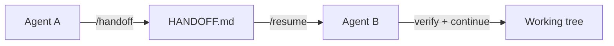

# AI Handoff Kit

**Stop losing context when you switch AI coding agents.**

A pair of portable Agent Skills that write a verified `HANDOFF.md` into your project and let the next agent pick up exactly where the last one stopped — without replaying the chat, re-reading the repo, or breaking uncommitted work.

Works with **OpenCode** and **Antigravity IDE**, and any agent that can read a Markdown skill file.

---

## Why

Switching tools mid-task usually costs more time than the task itself: you paste a summary, the new agent re-scans the repo, guesses what was finished, and sometimes rewrites work you already had. This kit replaces that with a structured, evidence-based brief stored next to your code.

## What you get

| Piece | Command | What it does |
| --- | --- | --- |
| **Handoff** | `/handoff` | Writes or replaces `HANDOFF.md` at the project root with the goal, constraints, verified repo state, decisions and exact next actions. |
| **Resume** | `/resume` | Reads `HANDOFF.md`, checks it against the live repository, and continues the first still-valid next action. |

Both skills are read-only with respect to your application code. Handoff never stages, commits, resets or discards anything, and resume treats newer repo changes as the source of truth.

## Install

Copy the kit into the **root of the project you want to hand off**. Merge folders — do not replace an existing `.agents` or `.opencode` directory.

```
your-project/
├─ .agents/
│  └─ skills/
│     ├─ handoff/
│     │  ├─ SKILL.md
│     │  └─ agents/openai.yaml
│     └─ resume/
│        ├─ SKILL.md
│        └─ agents/openai.yaml
└─ .opencode/
   └─ commands/
      ├─ handoff.md
      └─ resume.md
```

Or clone and copy:

```bash
git clone https://github.com/anmoldev06/ai-handoff-kit.git
cp -r ai-handoff-kit/.agents ai-handoff-kit/.opencode your-project/
```

## Usage

1. Working in **Agent A**, type `/handoff`. Add a focus if you want one, e.g. `/handoff finish the auth refactor`.
2. `HANDOFF.md` is written to the repository root.
3. Open the same folder in **Agent B** and type `/resume`.
4. Agent B reconciles the brief with the current branch, diffs and files, then continues.



## What's inside `HANDOFF.md`

A single, compact brief with fixed sections:

- **Header** — timestamp, project root, branch/HEAD, working-tree state
- **Goal and success criteria**
- **Requirements and constraints** — exact values and things not to change
- **Current state** — done, in progress, not started, blockers
- **Repository evidence** — relevant files and diff summaries
- **Decisions and context** — what was chosen and why
- **Verification** — commands actually run and their real results
- **Exact next actions** — ordered, executable steps
- **Suggested skills** and **safety notes** — fragile areas and work not to overwrite

Every claim is labelled `Verified in repository`, `Established in conversation`, or `Unverified / needs checking`, so the next agent knows what to trust.

## Design principles

- **Evidence over memory.** The repository is inspected before anything is written; test results are never invented.
- **Compact, not verbatim.** A continuation brief, not a transcript. Repetition is summarized, artifacts are referenced by path.
- **Safe by default.** No destructive Git operations, no code edits, no secret copying — credentials and `.env` values are redacted.
- **Resume, don't restart.** Completed work is never rebuilt, and uncommitted or untracked changes are preserved.

## Limitations

- A handoff is the active agent's available context plus repo evidence — not a perfect copy of the private chat history.
- It cannot save anything if the app crashes or the usage limit cuts the agent off before `/handoff` runs.
- Both agents need access to the same project folder; `HANDOFF.md` lives in the project root, never in a temp directory.
- Git state and diffs are read only — the handoff never changes them.

## Compatibility

| Tool | Discovery path | Slash commands |
| --- | --- | --- |
| OpenCode | `.agents/skills/*` | `.opencode/commands/*` |
| Antigravity IDE | `.agents/skills/*` | via skills |
| Other agents | Point them at `.agents/skills/handoff/SKILL.md` | — |

## License

No license file is included. Add one before redistributing if you need explicit terms.
